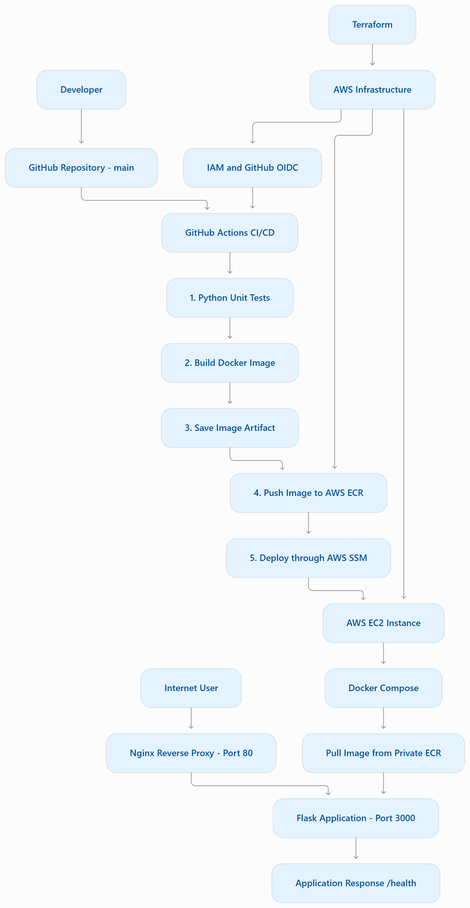

# Deploy a Web Application with Full CI/CD, IaC & Container Registry

## 1. Project Overview

This project demonstrates an end-to-end DevOps deployment workflow for a Python Flask web application using AWS, Docker, Terraform and GitHub Actions.

The infrastructure is provisioned using Terraform, the application is containerized using Docker, and GitHub Actions automates testing, image building, publishing and deployment.

The application is deployed on an AWS EC2 instance using Docker Compose, with Nginx acting as a reverse proxy.

## 2. Technology Stack

| Technology | Purpose |
|---|---|
| Python Flask | Web application |
| Python unittest | Application testing |
| Docker | Application containerization |
| Docker Compose | Container orchestration |
| Nginx | Reverse proxy |
| AWS EC2 | Application hosting |
| AWS ECR | Private Docker image registry |
| AWS Systems Manager | Remote deployment commands |
| AWS IAM | Access control |
| GitHub Actions | CI/CD automation |
| Terraform | Infrastructure as Code |
| GitHub | Source code management |

## 3. Architecture

The deployment follows this workflow:

1. Developer pushes code to the GitHub main branch.
2. GitHub Actions executes Python unit tests.
3. Docker builds the application image.
4. The image is pushed to the private AWS ECR repository.
5. GitHub Actions authenticates with AWS using OIDC.
6. AWS Systems Manager sends deployment commands to EC2.
7. EC2 pulls the image from ECR and starts the application using Docker Compose.
8. Nginx forwards incoming HTTP requests to the Flask application.
9. GitHub Actions verifies the application using the `/health` endpoint.

## 4. Project Structure

```text
cicd-webapp-assignment/
│
├── app/
│   ├── app.py
│   ├── requirements.txt
│   └── test_app.py
│
├── nginx/
│   └── nginx.conf
│
├── terraform/
│   ├── main.tf
│   ├── variables.tf
│   ├── outputs.tf
│   └── .terraform.lock.hcl
│
├── .github/
│   └── workflows/
│       └── deploy.yml
│
├── Dockerfile
├── docker-compose.yml
├── docker-compose.prod.yml
├── .gitignore
└── README.md
```

## 5. Application Endpoints

The Flask application exposes two HTTP endpoints.

| Endpoint | Description |
|---|---|
| `/` | Returns the application welcome message |
| `/health` | Returns application health status |

Deployed application:

- Application URL: http://13.236.85.230/
- Health endpoint: http://13.236.85.230/health

## 6. Docker Configuration

The application is containerized using a Dockerfile based on the Python 3.13 slim image.

Key configurations:

- Installs Python dependencies.
- Copies application files into the container.
- Creates and uses a non-root application user.
- Exposes application port 3000.
- Starts the Flask application.

Nginx listens on port 80 and forwards requests to the Flask application on port 3000.

## 7. Infrastructure as Code with Terraform

Terraform provisions the AWS infrastructure required for deployment.

Resources include:

- AWS VPC and public subnet.
- Internet Gateway and route table.
- Security group allowing HTTP traffic.
- EC2 instance running Amazon Linux 2023.
- IAM role and instance profile for EC2.
- Private AWS ECR repository.
- GitHub Actions OIDC identity provider.
- IAM role and permissions for GitHub Actions.

The EC2 instance uses AWS Systems Manager for remote command execution.

## 8. CI/CD Pipeline

The pipeline is defined in:

`.github/workflows/deploy.yml`

It contains five jobs:

### Stage 1: Run Python Unit Tests

- Installs Python dependencies.
- Executes application unit tests.
- Validates the root and health endpoints.

### Stage 2: Build Docker Image

- Builds the Docker image.
- Tags the image using the GitHub commit SHA.
- Saves the image as a workflow artifact.

### Stage 3: Push Docker Image to AWS ECR

- Authenticates with AWS through GitHub OIDC.
- Logs in to Amazon ECR.
- Pushes the Docker image to the private repository.

### Stage 4: Deploy Application to EC2

- Authenticates with AWS.
- Uses AWS Systems Manager to execute deployment commands.
- Configures Docker Compose and Nginx.
- Pulls the image from ECR.
- Starts the application containers.

### Stage 5: Verify Application Health

- Sends an HTTP request to the deployed `/health` endpoint.
- Confirms that the application responds successfully.

## 9. Authentication and Security

The project uses GitHub OIDC federation to authenticate GitHub Actions with AWS.

This avoids storing long-lived AWS access keys in GitHub repository secrets.

Other security measures:

- EC2 uses an IAM instance profile to access ECR.
- Application container runs as a non-root user.
- ECR repository is private.
- EC2 root storage is encrypted.
- EC2 metadata service requires IMDSv2.
- Security group exposes HTTP port 80 for application access.

## 10. Deployment Verification

The deployment was successfully tested.

| Verification | Result |
|---|---|
| Python unit tests | Passed |
| Docker image build | Passed |
| ECR image push | Passed |
| EC2 deployment | Passed |
| Application root endpoint | Passed |
| Application health endpoint | Passed |

## 11. Rollback Procedure

Each Docker image is tagged using its GitHub commit SHA.

To roll back an application change:

1. Identify the last known good commit in GitHub.
2. Identify the commit containing the problematic change.
3. Revert the problematic commit locally:

```bash
git revert <problematic-commit-sha>
```

4. Push the revert commit to the main branch:

```bash
git push origin main
```

5. GitHub Actions automatically runs the pipeline again and deploys the reverted application version.

This creates a new image from the reverted source code and deploys it through the normal CI/CD workflow.

## 12. Future Improvements

Possible improvements include:

- Docker image vulnerability scanning.
- Automated test coverage reporting.
- Remote Terraform state management.
- HTTPS configuration using TLS certificates.
- Application monitoring and centralized logging.
- Deployment notifications.
- Automated rollback based on health-check failures.

## 13. Repository

GitHub Repository:

https://github.com/subbgayathri903/cicd-webapp-assignment

---

**Project Status: Successfully Deployed**

This project demonstrates automated application testing, Docker containerization, private image registry integration, Infrastructure as Code and AWS-based continuous deployment.
